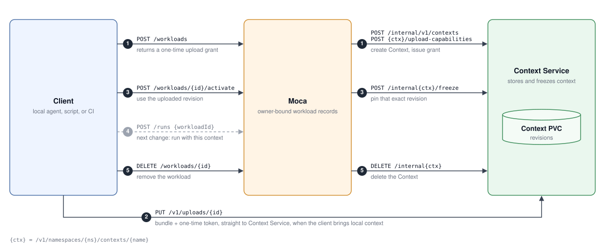

# Context Service and workloads

A Moca workload is a user's private environment for delegated tasks: where those tasks run and the
context they work from. Only the user who creates it can use it.

In this first phase, a workload provides only the context. Its files live in a Context stored by
[Context Service](https://github.com/rossoctl/context-service), which accepts uploads and freezes
revisions through a trusted API
([rossoctl/context-service#52](https://github.com/rossoctl/context-service/pull/52)). Moca keeps
the workload record. The tasks themselves run on the operator's shared, statically provisioned
sandboxes. A later phase gives each workload its own sandboxes and, optionally, a durable PVC
([#476](https://github.com/rossoctl/moca/issues/476)).

The client talks to Moca for the workload's lifecycle and sends the context bytes straight to
Context Service:



1. **Create:** `POST /workloads` creates the workload and its Context, and returns a one-time upload
   grant.
2. **Upload:** when the client brings local context, it sends the bundle straight to Context Service
   with that grant. Moca never handles the bytes.
3. **Activate:** `POST /workloads/{id}/activate` names the uploaded revision; Context Service freezes
   it.
4. **Run:** a synchronous `POST /runs` with a `workloadId` runs the prompt on a shared sandbox with
   the workload's frozen revision available read-only, or as a writable copy for that run.
5. **Delete:** `DELETE /workloads/{id}` deletes the Context, then the workload.

`mocactl` is the client for this flow
([#495](https://github.com/rossoctl/moca/issues/495), one CLI for delegating subagent tasks;
[#517](https://github.com/rossoctl/moca/issues/517), seed sandbox files before a leaf runs):
`mocactl workloads create --context FILE` does steps 1 to 3, `mocactl spawn --kind prompt --workload ID`
step 4, and `mocactl workloads delete ID` step 5. It does not build the context file:
`contextctl ctx pack <dir> -o FILE` does, which packs the directory's files under the bundle's
`workspace/` directory. `pack` needs a Context Service with [rossoctl/context-service#56](https://github.com/rossoctl/context-service/pull/56) (workspace bundles), on the server as well as
the client. See "Delegate with context" in
[`packages/mocactl/README.md`](../packages/mocactl/README.md).

The routes are off by default. With them off, every `/workloads` route answers
`501 workloads_unavailable`.

## Routes

Every route takes the user's control-plane API token (`Authorization: Bearer`, scope `api`), even
when `SH_REQUIRE_AUTH` is off. A missing token is `401 token_required`; a session token or a bad
token is `401 token_invalid`.

| Route                                            | Success                            | Errors                                                          |
| ------------------------------------------------ | ---------------------------------- | --------------------------------------------------------------- |
| `POST /workloads`                                | `201` workload plus `upload` grant | `400`, `409 workload_name_taken`, `429 workload_quota_exceeded` |
| `POST /workloads/{name}/uploads`                 | `201` a fresh grant                | `404`, `409 workload_not_awaiting_upload`                       |
| `POST /workloads/{name}/activate` `{"revision"}` | `200` workload, status `ready`     | `400 revision_invalid`, `404`, `409`                            |
| `GET /workloads/{name}`                          | `200` workload                     | `404`                                                           |
| `DELETE /workloads/{name}`                       | `204`                              | `404`, `409`                                                    |

`POST /workloads` takes `name` (a lowercase Kubernetes name of at most 50 characters; generated if
omitted), `contextType` (`workspace`, the default, `state`, `memory`, `knowledge` or `artifacts`)
and `workspace` (`size` in `Mi` or `Gi`, default `1Gi`, and an optional `storageClass`). Other
fields are refused. Moca creates the Context and returns a one-time grant: the client PUTs its
bundle to `upload.uploadUrl` with `upload.token`. Moca never handles bundle bytes. The grant
expires after five minutes; `POST .../uploads` issues another while the workload awaits upload.

`POST .../activate` names the revision that the upload returned. Context Service freezes it and the
workload becomes `ready`. Context Service's `409` codes pass through, for example
`revision_mismatch` when that revision is not the one uploaded. Repeating an activation with the
same revision is a no-op.

`DELETE` deletes the Context, then marks the workload `deleted` and frees its name and quota. If
Context Service fails, the workload stays `deleting` and a repeated `DELETE` retries.

A workload record moves through a fixed state machine — `creating` → `awaiting_upload` → `ready` →
`deleting` → `deleted`, with no other transitions — and every record write is a compare-and-set on
the record's `generation` and status. A `deleted` record cannot become active again: activation and
upload grants refuse it, and it expires after `MOCA_WORKLOAD_DELETED_TTL_SECONDS` (a day by
default), after which the name is reusable. A re-created name gets a new `generation` and a new
Context, so a request from before the delete cannot act on the workload that now owns the name.
`GET` is read-only: it reports the stored status, `deleting` and `deleted` included, and never
writes the record, so a read can neither resurrect a deleted workload nor overwrite a concurrent
lifecycle change.

A request that loses a race with another lifecycle request, such as an activation racing a delete,
answers `409 workload_state_changed` and changes nothing. Context Service failures answer
`502 context_service_error`.

## Runs

A run on a workload is a synchronous prompt run (`"kind": "prompt"`) with a `workloadId`, made with
a session token (scope `turn:write`). The token's user must own the workload: another user's
workload, like a missing one, is `404 workload_not_found`. A workload that is not `ready` answers
`409 workload_not_ready`, and another kind of run `400 workload_run_requires_prompt`. A synchronous
run with no token is `401 token_required`. Asynchronous runs on a workload, and every workload run
while the routes are off, answer `501 workload_runs_unavailable`; an asynchronous run gets it before
the general `501 async_runs_unavailable` for tokened callers. Authentication still comes first: on a
deployment with `SH_REQUIRE_AUTH=true` (as `deploy/k8s` sets), a request with no token is
`401 token_required` before either check. The
sandbox tier is the session's, chosen as for any other run.

Delivery is lazy. Moca downloads the frozen bundle from Context Service's trusted export
(`GET /internal/v1/namespaces/{ns}/contexts/{name}/revisions/{sha256}/bundle`) only when the
selected sandbox lacks that revision, once per revision: concurrent runs share one download, and a
bounded in-memory cache, keyed by user, Context and revision, serves later ones. Deleting a workload
drops its cached bundles. Downloads in flight share a byte budget: each reserves its
`Content-Length`, or the size ceiling when the length is unknown, before buffering, and waits up to
the export timeout for budget to come free. A bundle over the size ceiling, that inflates past the
expanded ceiling, or with an incomplete gzip stream is refused and never cached. The harness copies
the raw bytes over SandboxExec in 8 MiB chunks, checks their sha256 in the sandbox, refuses an
archive with more entries than the entry limit, extracts it read-only (write permission removed;
directories stay traversable and executable files keep their exec bit) and publishes the revision
atomically under `flock`.
The run gets its own view at `/workspace/.moca-context/runs/<session>`, and the agent starts there:
the view is the run's working directory, the directory its tools run commands in, as a solve leaf
starts in its worktree. When the revision's only content is a top-level `workspace/` directory,
which is where `contextctl ctx pack` puts a directory's files, the view shows that directory, so
`src/` sits at the root of the working directory. Otherwise, including when the revision also has
`harnesses/`, `memory/`, `knowledge/` or `artifacts/`, the view shows the whole revision, so nothing
is hidden. Only a real directory
counts: a `workspace` link in the bundle is ignored. The prompt tells the agent its working
directory and, for a read-only run, that the session's own working directory
(`/workspace/<session>` on container workers) is writable scratch space. Each user's copy is cached separately, so two users never share one, even
for identical content. Only P6 sandboxes (Moca's long-running sandbox workers, reached through the
relay) are supported: a run whose sandbox is reached another way fails without running a turn.

The sha256 check in the sandbox proves transport integrity only: the extracted bytes are the ones
Moca downloaded. It does not prove they are the pinned revision. A Context Service revision is a
digest of the Context's files (their paths, checksums and sizes), not of the compressed bundle, and
the bundle carries no record from which Moca could recompute it exactly. Moca trusts Context
Service's authenticated export for the revision's identity.

**Writable copies.** A run that also sets `"contextWritable": true` gets its own writable copy of
the revision instead of a read-only view, for tasks that edit files, rerun tests or build
([#532](https://github.com/rossoctl/moca/pull/532) (writable per-run copy)). The harness first
places the revision in the sandbox's read-only cache as usual, then copies what the view would show
(its `workspace/` directory when that is its only content root) with `cp -a` into a staging directory, makes the copy
writable for the agent, and renames it into place, so the run's path is a real directory, never a
partial one. The cached copy stays read-only and is shared, ref-counted and swept as for any other
run. The copy is the run's working directory. The prompt tells the agent the copy is writable and is
discarded when the run ends, so the agent should return any changes, such as a diff or test output,
in its response. Exec bits survive the copy, so a bundled `./test.sh` runs as is. `contextWritable`
must be a boolean (`400 context_writable_invalid`), and `true` needs a `workloadId`
(`400 context_writable_requires_workload`); `false` is ignored.

Read-only is enforced by file permissions only: the agent runs as the same user as the files and
could change them. Each user's copy is its own, under a cache name derived with an HMAC under a
secret the agents never see, so an agent cannot compute another user's name and plant a copy for a
revision it knows. It can still alter, and learn the name of, any copy present on the sandbox.
Enforcing read-only with a mount or a separate user comes with per-workload sandboxes
([#476](https://github.com/rossoctl/moca/issues/476), phase 2 workloads).

**Multiple users.** Several users can create workloads and run tasks at once: names, ownership,
Contexts and sandbox caches are per user. The sandboxes themselves are shared, though, and are not
a security boundary between users: tasks from different users can run on the same sandbox, as the
same Linux user, one after another. Per-user sandboxes come with #476.

After the run, its view, or its writable copy, is removed and, by default, so is any revision no
run still uses. A writable copy left by a harness that died is swept a day later, as abandoned
uploads are. Shared sandboxes serve several users, so a user's context should not stay on them for
the next user's task. `MOCA_CONTEXT_SANDBOX_RETAIN_MINUTES` keeps unused revisions longer, which
saves a transfer for repeated runs at the cost of leaving that context on the sandbox for the
period.

## Own sandboxes (phase 2)

A workload can get sandboxes of its own instead of the shared pool
([#476](https://github.com/rossoctl/moca/issues/476), per-workload sandboxes; design in
[`specs/2026-10-16-workload-sandboxes-design.md`](specs/2026-10-16-workload-sandboxes-design.md),
decision in [ADR-0043](adrs/0043-workload-sandboxes-provisioner.md)). It is off by default: it needs
`moca-provisioner` and `MOCA_PROVISIONER_URL` on the workers (on Kubernetes,
`SH_WORKLOAD_SANDBOXES=1 deploy/k8s/setup.sh ...`). Without it, `sandboxes` is refused as any
unknown field is (`400 workload_field_not_allowed`), and everything above is unchanged.

`POST /workloads` takes `"sandboxes": {"count": 1, "tier": "container"}`. `count` is 1 to
`MOCA_WORKLOAD_MAX_SANDBOXES` (default 2, `400 sandboxes_count_invalid` otherwise). `tier` is
`container`, the default; `microvm` answers `400 sandbox_tier_unavailable`, because microVM hosts sit
outside the cluster.

1. **Activate** freezes the revision as before, then the record moves to `provisioning` and Moca asks
   the provisioner for the sandboxes. The answer is `202` with `status: provisioning`.
1. The provisioner creates a StatefulSet, a headless Service and a Secret holding a signed attach
   token, all named after the workload's derived Context name, in `moca-sandbox`. The pods start
   from the PodTemplate `moca-workload-sandbox` (below). They attach to the relay with that token,
   and the relay labels their records with the workload and its owner from the token alone.
1. **`GET`** (or a repeat activate) counts the workload's attached sandboxes and moves the record to
   `ready` once all `count` are there. Until then runs answer `409 workload_not_ready`. `GET` shows
   `sandboxes: {count, tier, ready}`.
1. **Runs** execute only on the workload's own sandboxes, of the same owner. The context still
   arrives by copy, as above, now onto those sandboxes. When none is attached (a pod restarting),
   the run answers `503 workload_sandbox_unavailable` with `Retry-After`; it never falls back to the
   shared pool. A worker that can never serve it (no relay sandbox pool) fails the run instead.
1. **Delete** removes the sandboxes first and waits until no pod remains, then deletes the Context
   and the record. If pods are still terminating after `MOCA_PROVISIONER_DELETE_WAIT_MS` (default
   60 s), it answers `202` with `status: deleting`, and a repeated `DELETE` finishes it.

A failed provisioning leaves the record in `provisioning` with an `error` field, since a frozen
revision cannot be unfrozen; a repeat activate with the same revision retries. The `error` goes once
the record is `ready`, so a request that timed out but did create the sandboxes leaves no trace. The
provisioner's refusals pass through on activate:

| Answer                             | Meaning                                                                                                                              | Way out                                                     |
| ---------------------------------- | ------------------------------------------------------------------------------------------------------------------------------------ | ----------------------------------------------------------- |
| `429 owner_sandbox_quota_exceeded` | The owner's sandboxes across all workloads would exceed `MOCA_OWNER_MAX_SANDBOXES` (default 4). Has `Retry-After`.                   | Delete another workload, then repeat the activate           |
| `400 sandboxes_count_exceeded`     | `count` is above the provisioner's `MOCA_WORKLOAD_MAX_SANDBOXES`, which is lower than the workers'. An operator mismatch.            | `DELETE`, then re-create                                    |
| `400` (other `sandbox*` codes)     | The provisioner refused the request itself (`sandbox_tier_unavailable`, `sandboxes_count_invalid`, ...).                             | `DELETE`, then re-create                                    |
| `409 workload_object_conflict`     | An object under the workload's derived name in `moca-sandbox` is not this workload's.                                                | An operator removes it                                      |
| `422 workload_refused`             | The cluster refused the workload's objects: the admission policy (an operator's PodTemplate outside its rules) or an invalid object. | An operator fixes the PodTemplate, then repeat, or `DELETE` |
| `502 provisioner_error`            | The provisioner could not be reached, or Kubernetes failed behind it.                                                                | Repeat the activate                                         |

A refusal no repeat can fix leaves the record `provisioning` with that `error`: the revision is
frozen, so `DELETE` (which removes whatever was created) is the way out.

The worker presents its service token (`MOCA_PROVISIONER_TOKEN`) and forwards the caller's API token.
The provisioner verifies that token itself and derives the workload's names from its owner, so a
worker can provision only for users whose tokens it holds. The attach token lasts
`MOCA_ATTACH_TOKEN_TTL_S` (default a day) and is re-minted once half of that is left; the sandbox
reconnects with the new one when no command is running.

**What the provisioner can do.** Its Role covers StatefulSets, Services and Secrets in
`moca-sandbox`, but it never reads a Secret: it writes each workload's token blind and keeps the
token's expiry on the StatefulSet (`moca.dev/attach-exp`). A ValidatingAdmissionPolicy (Kubernetes
1.30 or newer) holds what it writes to workload names (`w-<32 hex>`, `w-<32 hex>-attach`), to a
headless, port-less Service selecting only the workload's own pods, and to a pod whose volumes are
only `emptyDir`, `configMap`, `downwardAPI` and its own token Secret, that runs as
`moca-workload-sandbox` with no service-account token, and uses no host namespace or privileged
container. Its egress is the Kubernetes API
server's addresses only, which `setup.sh` reads from the `kubernetes` Service. It runs as exactly one
replica: the per-owner cap, and the order of one owner's activations, deletes and token re-mints, are
serialized inside the process. Never scale it: a second replica makes the cap advisory. A request
that only keeps or lowers a workload's `count` is never refused by the cap.

**The pod template.** The PodTemplate `moca-workload-sandbox` in `moca-sandbox`
(`deploy/k8s/base/workload-sandboxes/template.yaml`) is what every workload sandbox starts from: the
shared pool's image, resources, relay address and hardening, without its relay token. Patch it in an
overlay like any other manifest; the admission policy holds the result to the rules above. It is read
when a workload's StatefulSet is created, so a change reaches workloads created after it.

**Turning it off.** `SH_WORKLOAD_SANDBOXES=` removes the provisioner and its objects, and is refused
while any workload's sandboxes exist: delete those workloads first, or pass
`--delete-workload-sandboxes` to delete their StatefulSets, Services and Secrets with it. It
stops the provisioner before it checks, so no activate can add sandboxes in between. The
workload records stay: their runs answer `503 workload_sandbox_unavailable`, and deleting them needs
the feature on again, so prefer deleting the workloads first.

## Names are per user

Each user has their own names: two users can each own `demo`. Another user's workload is
indistinguishable from a missing one (`404 workload_not_found`, never `409`). This is the first half
of [rossoctl/moca#358](https://github.com/rossoctl/moca/issues/358) (per-user PVC authorization).

The Context's name in Context Service is derived from the owner, the workload name and that
reservation, so it is unique per user and per re-creation and does not reveal the owner. Moca never
returns it, nor the Context's identity. Context Service records the user (`user:<subject>`) as the
Context's owner.

## Settings

| Variable                                 | Meaning                                                                                                                                                                                                                                                                                                                                                                                                       |
| ---------------------------------------- | ------------------------------------------------------------------------------------------------------------------------------------------------------------------------------------------------------------------------------------------------------------------------------------------------------------------------------------------------------------------------------------------------------------- |
| `MOCA_CONTEXT_WORKLOADS_ENABLED`         | `1` turns the routes on, together with `CONTEXT_SERVICE_URL`                                                                                                                                                                                                                                                                                                                                                  |
| `CONTEXT_SERVICE_URL`                    | Internal base URL of Context Service                                                                                                                                                                                                                                                                                                                                                                          |
| `CONTEXT_SERVICE_TOKEN`                  | Bearer Context Service accepts for its trusted routes                                                                                                                                                                                                                                                                                                                                                         |
| `CONTEXT_SERVICE_PUBLIC_URL`             | Base URL clients upload to; HTTPS, or HTTP on loopback only                                                                                                                                                                                                                                                                                                                                                   |
| `CONTEXT_SERVICE_NAMESPACE`              | Context namespace; defaults to `POD_NAMESPACE`, then `default`                                                                                                                                                                                                                                                                                                                                                |
| `CONTEXT_SERVICE_TIMEOUT_MS`             | Per-request timeout, default `5000`                                                                                                                                                                                                                                                                                                                                                                           |
| `MOCA_CONTEXT_MAX_WORKLOADS_PER_OWNER`   | Live workloads per user, default `5`                                                                                                                                                                                                                                                                                                                                                                          |
| `MOCA_CONTEXT_MAX_STORAGE_GIB`           | Largest `workspace.size`, default `10`                                                                                                                                                                                                                                                                                                                                                                        |
| `MOCA_CONTEXT_STORAGE_CLASSES`           | Comma-separated StorageClasses a caller may name; empty allows none                                                                                                                                                                                                                                                                                                                                           |
| `MOCA_WORKLOAD_DELETED_TTL_SECONDS`      | How long `GET` still reports a deleted workload, default `86400`                                                                                                                                                                                                                                                                                                                                              |
| `MOCA_CONTEXT_ROLLBACK_RETRY_ATTEMPTS`   | Attempts at the create-rollback's Context Service cleanup, including the first, while Context Service is unreachable, default `3` (so up to 2 retries after the first attempt). `1` means no retry. Each attempt can take up to `CONTEXT_SERVICE_TIMEOUT_MS`; against a black-holed Context Service, a failed create answers in roughly `attempts × CONTEXT_SERVICE_TIMEOUT_MS + (attempts - 1) × backoff` ms |
| `MOCA_CONTEXT_ROLLBACK_RETRY_BACKOFF_MS` | Backoff between those attempts, default `500`                                                                                                                                                                                                                                                                                                                                                                 |
| `MOCA_CONTEXT_BUNDLE_MAX_BYTES`          | Largest bundle a run downloads, default `268435456` (256 MiB)                                                                                                                                                                                                                                                                                                                                                 |
| `MOCA_CONTEXT_BUNDLE_MAX_EXPANDED_BYTES` | Most a bundle may inflate to, default `1342177280` (1.25 GiB)                                                                                                                                                                                                                                                                                                                                                 |
| `MOCA_CONTEXT_BUNDLE_MAX_ENTRIES`        | Most entries a bundle may hold, default `10000`                                                                                                                                                                                                                                                                                                                                                               |
| `MOCA_CONTEXT_BUNDLE_CACHE_BYTES`        | Moca's in-memory bundle cache, default `67108864` (64 MiB)                                                                                                                                                                                                                                                                                                                                                    |
| `MOCA_CONTEXT_DOWNLOAD_BUDGET_BYTES`     | Bytes all downloads in flight may buffer, default `536870912` (512 MiB)                                                                                                                                                                                                                                                                                                                                       |
| `MOCA_CONTEXT_EXPORT_TIMEOUT_MS`         | Timeout for one bundle download, default `300000`                                                                                                                                                                                                                                                                                                                                                             |
| `MOCA_CONTEXT_CACHE_SECRET`              | Secret for the sandbox cache names; random per process if unset                                                                                                                                                                                                                                                                                                                                               |
| `MOCA_CONTEXT_SANDBOX_RETAIN_MINUTES`    | Minutes an unused revision stays on a sandbox, default `0`                                                                                                                                                                                                                                                                                                                                                    |

A missing token or an unsafe public URL answers `500 workloads_misconfigured`.

A writable run keeps the cached revision and its own copy, so it takes up to twice the expanded
limit on the sandbox's disk while it runs, plus what the agent writes. There is no separate limit
for it.

The entry limit matches Context Service's upload limit. The expanded limit is a quarter above
Context Service's 1 GiB, because it also counts tar headers and padding. The download budget must
be at least `MOCA_CONTEXT_BUNDLE_MAX_BYTES`: a download that could never fit is refused at once.

On Kubernetes, `deploy/k8s` reads these from an optional `moca-context-service` ConfigMap (keys
`enabled`, `url`, `public-url`, `namespace`) and Secret (key `token`), and allows the supervisor to
reach pods labelled `app.kubernetes.io/name: context-service` on port 8080 in the `context-service`
namespace:

```bash
kubectl -n moca create configmap moca-context-service \
  --from-literal=enabled=1 \
  --from-literal=url=http://context-service.context-service.svc:8080 \
  --from-literal=public-url=https://context.example.com
kubectl -n moca create secret generic moca-context-service --from-literal=token="$CS_TOKEN"
kubectl -n moca rollout restart deployment/moca-supervisor
```

## Upgrading

Workloads created by Moca versions before
[#469](https://github.com/rossoctl/moca/pull/469) (stopped calling Context Service sandbox pools)
are not released for you: those versions kept their sandboxes in Context Service, which no longer
manages sandbox pools. Delete their Sandboxes and workspace PVCs with `kubectl`, as the Context
Service migration note describes (`docs/api.md`, "Removed: sandbox pools"). Then delete Moca's
legacy workload records, which were stored in Redis without a TTL:

```bash
redis-cli --scan --pattern 'sh:workload:*' | xargs -r redis-cli del
```

Current workloads are stored under `sh:wl:` keys, which that pattern does not match.
