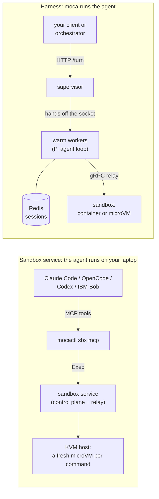

# Moca

Moca is the rossoctl project for running AI coding agents safely and at scale. It has **two
capabilities**. You can use either one on its own, or both together.

|                       | **Moca sandbox service**                                                                                            | **Moca harness**                                                                                                          |
| --------------------- | ------------------------------------------------------------------------------------------------------------------- | ------------------------------------------------------------------------------------------------------------------------- |
| **In one line**       | Your coding agent stays on your laptop, and every command it runs goes to a fresh, isolated VM on a shared service. | Moca runs the agent itself: long-lived sessions on a warm worker pool, with state in Redis and tools in a remote sandbox. |
| **Who uses it**       | Developers using Claude Code, OpenCode, Codex or IBM Bob                                                            | Teams and orchestrators that send agent work over HTTP, or users of `mocactl`                                             |
| **You drive it with** | `mocactl sbx`                                                                                                       | The HTTP API (`/turn`, `/v1/runs`) or `mocactl`                                                                           |
| **What you get back** | The agent's edits, as a patch you apply (`mocactl sbx pull --apply`)                                                | Replies, streamed or not, from sessions that resume by `sessionId`                                                        |
| **Where it runs**     | You host it: an OpenShift cluster plus KVM hosts                                                                    | A laptop (Docker Compose), a single VM, or Kubernetes / OpenShift                                                         |
| **Start here**        | [Sandbox quickstart](sandbox/quickstart.md)                                                                         | [Harness quickstart](harness/quickstart.md)                                                                               |

## How the two fit together

Both capabilities keep an agent's **commands away from the agent's own process**. They differ in
_where the agent runs_.

- **Shared parts.** Both use moca's sandbox relay and its sandbox workers, which dial _out_ to the
  relay, so a sandbox needs no inbound route. Both can run each command in its own Firecracker
  microVM.
  ([Sandboxes and tiers](concepts/sandboxes-and-tiers.md),
  [Install the sandbox service](../deploy/sbx/README.md))
- **One control plane, three profiles.** The same control-plane component serves the harness, the
  sandbox service, or both (`SH_ROUTE_PROFILE` = `harness`, `sandbox` or `combined`). With
  `combined`, one deployment serves sessions and sandboxes from a single template store.
  ([One control plane for both](../deploy/sbx/README.md#one-control-plane-for-sessions-and-sandboxes))
- **Two different "sandboxes".** A harness session runs its tools in the harness's own sandbox. A
  sandbox-service workspace is a separate thing: `mocactl sbx` commands neither see nor manage a
  harness session's sandbox. The [glossary](glossary.md) defines both.

## Which one do I want?

| If you want to…                                                                              | Use                                   |
| -------------------------------------------------------------------------------------------- | ------------------------------------- |
| Let a coding agent on your laptop edit and test code without running anything on your laptop | **Sandbox service**                   |
| Hand an agent a repository and get a reviewable patch back                                   | **Sandbox service**                   |
| Run many agent sessions on a few warm processes, resumable after a restart                   | **Harness**                           |
| Dispatch units of agent work ("leaves") from your own orchestrator over HTTP                 | **Harness**                           |
| Run harness sessions and sandboxes on one control plane                                      | **Both**, with the `combined` profile |

Not a fit today:

- **A sandbox service on your laptop.** The sandbox service deploys only to OpenShift plus a KVM
  host, so you, or your team, deploy it before anyone can use it. The harness has a five-minute
  local trial.
- **Scheduled dispatch.** The harness runs synchronous turns, streaming and detachable turns,
  human-gated runs and opt-in async fan-out. Scheduled dispatch has no design on the current
  runtime yet ([#536](https://github.com/rossoctl/moca/issues/536)).
- **A hosted service.** Moca is open source for you to self-host: there is no moca-run endpoint.
  Every deployment path is **Preview**, so interfaces and limits may still change ([Maturity and lifecycle](reference/maturity-and-lifecycle.md)).

## Find your path

- **Evaluating moca?** Read the table above, then [Get started](get-started/index.md), which
  says what each path needs. The [harness quickstart](harness/quickstart.md) runs on a laptop
  in about five minutes.
- **Using the sandbox service?** You need the URL of your sandbox service deployment. Start with the
  [sandbox quickstart](sandbox/quickstart.md).
- **Building on the harness?** Start with the [harness quickstart](harness/quickstart.md), then
  [the mocactl README](../packages/mocactl/README.md).
- **Deploying or operating moca?** Start with [Deploy and operate](operate/index.md). It says
  which deployment delivers which capability.

## Status

Moca is open source (Apache-2.0), for self-hosting, and in **Preview**. The latest release is
[v0.10.0](https://github.com/rossoctl/moca/releases/tag/v0.10.0). Container images are
`ghcr.io/rossoctl/moca` and `ghcr.io/rossoctl/moca-remote-worker`. These pages track moca's `main`
branch.

<!-- Sources: packages/mocactl/src/sbx/cli.ts:95-106 (SBX_ABOUT), :156 (`sbx mcp` stdio server);
docs/sandbox/user-guide.md:11-33 (what you get, agents, safety); README.md:11-17, :93-101 (supervisor,
warm workers, Redis, sandbox tiers); docs/concepts/brain-and-hands.md:5-16;
docs/concepts/sandboxes-and-tiers.md:12-20; remote-worker/DESIGN.md:12-17 and glossary.md:80-86
(workers dial out); deploy/sbx/README.md:1-6 (OpenShift + routes), :197-211 (KVM hosts,
microvm-worker), :279-303 (combined); packages/control-plane/src/sandbox-config.ts:87-94 (route
profiles); README.md:204-210 and issue #536 (dispatch shapes, scheduled dispatch);
docs/reference/maturity-and-lifecycle.md:9-13, README.md:291-296 (Preview, Apache-2.0);
`gh release list -R rossoctl/moca` on 2026-11-17 (v0.10.0); .github/workflows/build.yaml:29, :37 (images). -->
