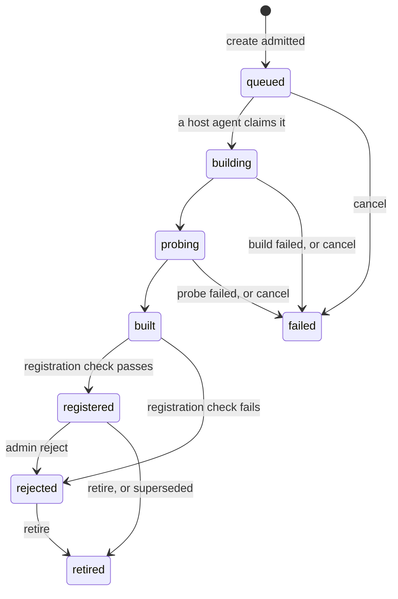
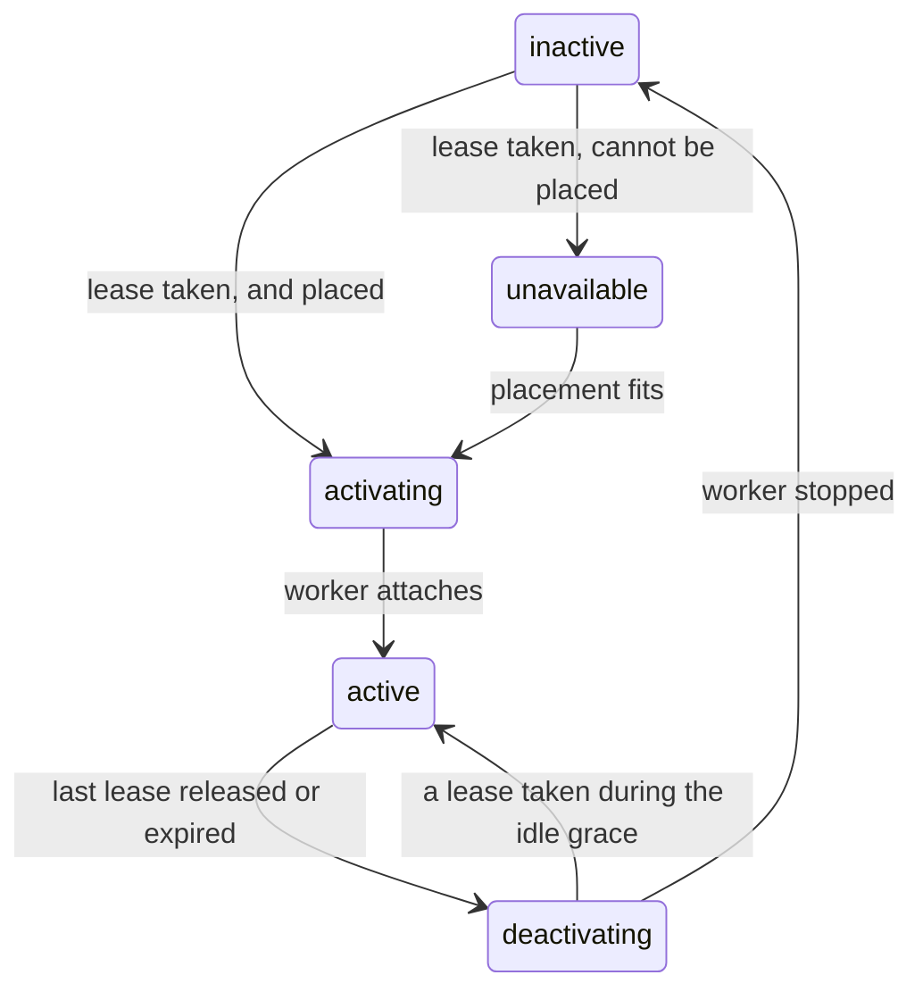

# Templates, builds and activation

> **Preview.** Self-serve templates, their builds and activation are implemented but not yet
> declared Stable; interfaces and limits may change. Known limits: [Limits](limits.md).

This page is the model behind `mocactl sbx templates`. To make and use a template, see
[Make your own templates](../how-to/templates.md); every route, error code and rule id is in the
[Template API](../reference/templates-api.md).

## The model

- **A template is a name over immutable builds.** You bring an image pinned by digest and a spec:
  guest size, vCPUs, workspace size, egress, the seed that fills `/workspace`, a probe and the
  tools it carries. A **build** turns them into one snapshot of a booted microVM, so every sandbox of
  that build starts from the same snapshot. A registered build's id is its snapshot's manifest hash
  (`sha256:…`). A build never changes: a new image or spec is a new build.
- **A tag names a registered build.** `default` is what a bare template id names. It can be moved
  to another build, but never removed. Moving a tag rebuilds nothing, and sandboxes and sessions
  already created keep their build.
- **A policy, not a person, admits a build.** An admin writes the policy as named **profiles**
  (the gating rules a create must pass, and a size envelope). A create is checked against it before
  anything is queued, and the built snapshot is checked again before it is registered.
- **The control plane keeps the facts; host agents do the work.** The control plane holds the
  catalog (templates, builds, tags, leases), the policy and the provenance records on a persistent
  volume (`SH_PROVENANCE_DIR`), not in Redis. A host agent on each KVM host polls it and never
  listens. It reports what the host holds, claims queued builds, builds and probes them, reports
  the result, and starts or stops the workers the control plane wants on that host
  ([The template host agent](../../operate/sandbox-service/runbook.md#the-template-host-agent)).
- **A worker runs only while someone holds an activation lease.** An **activation lease** is a
  claim one subject holds on one build, granted for 60 s to one day and renewed by activating
  again, without limit. The control plane places a leased build on a host that holds its snapshot,
  within that host's active limit, memory headroom and start pacing. It never evicts a leased
  build to make room.
- **Every step is a record in a hash chain.** Each provenance record is canonical JSON, named by
  its sha256 and naming the digest of the record before it. Nothing is signed: integrity is the
  chain of digests, and an export verifies offline with a Python script that needs nothing but the
  standard library
  ([Provenance records](../../operate/sandbox-service/runbook.md#provenance-records-export-verify-and-redact)).

An activation lease is not [lease mode](../how-to/lease-mode.md). An activation lease keeps a
build's **worker** running on a host. Lease mode keeps one sandbox's **VM** between its commands,
inside that worker. Neither sets the other ([glossary](../../glossary.md#activation-lease)).

## A build's onboarding status

A build has two states, both kept by the control plane: its onboarding `status` (how far it is
from usable) and, once registered, its `readiness` (whether it can serve now). A template's own
`onboarding` is `registered` once any build is, else its newest build's status. Its `readiness`
is its `default` build's.

| `status`     | Means                                                                                           | Entered by                                      |
| ------------ | ----------------------------------------------------------------------------------------------- | ----------------------------------------------- |
| `queued`     | admitted by the create-time checks; waiting for a host                                          | the create                                      |
| `building`   | a host agent claimed it: pull, root filesystem, boot, snapshot                                  | the agent's claim                               |
| `probing`    | restored from the new snapshot; the seed and the probe running                                  | the agent's report                              |
| `built`      | the snapshot and the probe passed                                                               | the agent's report                              |
| `registered` | the registration check passed; usable                                                           | the control plane                               |
| `rejected`   | refused at registration (`reason.rule` names the rule), or rejected later by an admin (`admin`) | the control plane; an admin                     |
| `failed`     | the build or the probe failed (`reason.message`, `reason.step`), or it was cancelled            | the agent's report; a cancel                    |
| `retired`    | never served again; its records stay                                                            | the owner or an admin; a rebuild superseding it |



- **A create the policy refuses leaves no build.** It is `422 policy_refused`, naming the rule.
- **`built` is brief.** The contract lists it, but the current control plane takes the host's
  `built` report and runs the registration check in one catalog update, so a reader sees `probing`
  and then `registered` or `rejected`.
- **A cancel** applies to a `queued`, `building` or `probing` build. The build becomes `failed`
  with `reason.step: cancelled`, and the host's later reports for it are refused, so it never
  registers.
- **A retire** applies to any build not yet retired, including one that never registered (its
  `buildId` is then null). The diagram shows only the common paths. A retire cannot be undone: a
  new build is the way back. A rebuild of the same snapshot can also retire the build it replaces
  (`reason.step: superseded`). Its leases and tags, `default` included, then move to the rebuild.
- **An admin reject** applies to a registered build only, so a retired build cannot be rejected.
  It cannot be undone either.
- **On use**, a retired build answers `410 template_retired`, and a rejected one answers
  `400 unknown_template`, as an unknown build does.

## A registered build's readiness

| `readiness`    | Means                                                                      | Extra fields                                                                         |
| -------------- | -------------------------------------------------------------------------- | ------------------------------------------------------------------------------------ |
| `inactive`     | no lease, and no worker attached                                           |                                                                                      |
| `activating`   | a lease stands and a host holding it is asked to run it; not attached yet  | `queued` and `queuePosition` while it waits for a start slot                         |
| `active`       | its worker is attached to the relay: sandboxes and sessions can run        | `capacity {running, inUse}`                                                          |
| `deactivating` | attached with no lease: draining, or kept running in the host's idle grace | `graced: true` and `gracedUntil` while graced                                        |
| `unavailable`  | leased, but it cannot be placed                                            | `readinessReason`: `not_held`, `no_slot`, `memory` or `memfile_mismatch`             |
| `unknown`      | the relay's presence could not be read                                     |                                                                                      |
| `retired`      | the build is retired                                                       | `shared: true` when a build neither retired nor rejected uses its snapshot or worker |

Readiness follows facts, not intent: `active` means the relay holds an attached record for the
build's worker. Before any host agent reports, readiness is that presence alone (`active` or
`inactive`).



- **A lease is taken** by `mocactl sbx templates activate`, or by a sandbox or session create on a
  build that is not active. That create takes the lease for you and answers
  `409 template_not_active` with `Retry-After`: retry the same create after the wait. With
  `activate: false`, the create starts nothing.
- **The worker starts** at the host agent's next wanted-state run (every 15 s). Readiness then
  follows the relay's attached record, never the agent's reports.
- **The worker stops** only when no lease is left and no live sandbox runs on it. On a host with
  an idle grace it is kept running that long first, so a use soon after is warm; a release with
  `--stop-now` skips the grace.
- **Placement never evicts a leased build.** With no room, an activation answers
  `409 no_active_slot` with `Retry-After` (`reason: memory` when memory, not slots, is short).
  How hosts are sized, paced and filled is in
  [the runbook](../../operate/sandbox-service/runbook.md#the-template-host-agent).

## How a sandbox picks its build

A sandbox names its template in one of three forms:

| Reference  | Resolves to                              |
| ---------- | ---------------------------------------- |
| `ID`       | the build the `default` tag names        |
| `ID:TAG`   | the build tag `TAG` names                |
| `ID@BUILD` | that build, by its build id (`sha256:…`) |

```bash
mocactl sbx create --template my-python
mocactl sbx create --template my-python:stable
mocactl sbx create --template my-python@sha256:<64 hex>
```

- The reference resolves to one registered build at creation, and the sandbox keeps that build for
  its whole life. The sandbox shows it as `buildId` and `templateManifestHash`.
- An unknown id, tag or build, one you cannot see, or a build that is not registered is
  `400 unknown_template`. A retired build, or a template whose every build is retired, is
  `410 template_retired`.
- A tag that points at a retired build still resolves to it, and so answers `410`: move the tag
  to a live build first.
- A Moca Pi session names its template the same way
  ([Pin a session to a build](../how-to/templates.md#pin-a-session-to-a-build)).
