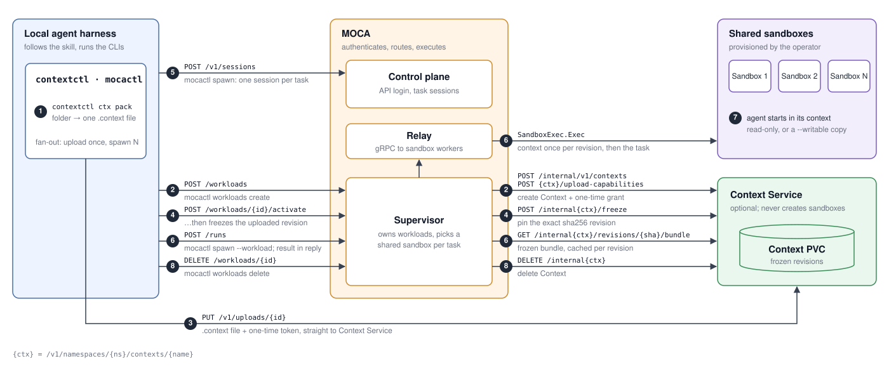

# How context delegation works

Your local agent follows the `moca-delegate-task` skill and runs two CLIs: `contextctl` packs a
folder into a `.context` file, and `mocactl` sends it to MOCA and runs tasks on it. MOCA runs each
task on one of the operator's shared sandboxes. Context Service stores the context; it never
creates sandboxes.

1. **Pack:** `contextctl ctx pack <dir> -o repo.context` turns the folder into one `.context` file.
2. **Create:** `mocactl workloads create --context repo.context` calls `POST /workloads` with your
   `mocactl` login. MOCA creates the workload's Context in Context Service
   (`POST /internal/v1/contexts`) and gets a one-time upload grant
   (`POST {ctx}/upload-capabilities`).
3. **Upload:** the same command sends the file straight to Context Service with that grant
   (`PUT /v1/uploads/{id}`). MOCA never handles the bytes.
4. **Activate:** it then calls `POST /workloads/{id}/activate`, and MOCA freezes that exact revision
   (`POST /internal{ctx}/freeze`).
5. **Session:** `mocactl spawn --workload <id> "…"` creates a session for the task on the control
   plane (`POST /v1/sessions`). Fan-out is one `spawn` per task, all on the same workload.
6. **Run:** the spawned task sends `POST /runs` naming the workload. The supervisor picks a shared
   sandbox, fetches the frozen revision once (`GET /internal{ctx}/revisions/{sha}/bundle`, then
   cached), and copies it in with the task through the relay (`SandboxExec.Exec`).
7. **Work:** the agent starts in the context: a read-only view, or with `--writable` its own copy
   that is discarded when the run ends. The result comes back in the `/runs` response;
   `mocactl subagents` and `mocactl get` show it.
8. **Clean up:** `mocactl workloads delete <id>` calls `DELETE /workloads/{id}`, and MOCA deletes
   the Context (`DELETE /internal{ctx}`).

`{ctx}` is `/v1/namespaces/{ns}/contexts/{name}`. For the server-side details (limits, caching,
error codes) see [Context Service and workloads](../../../docs/context-service.md).
